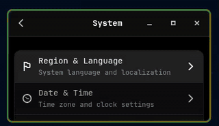

# Pretty Borders

A GNOME Shell extension that adds colorful, animated borders around your active window. The border color smoothly cycles through the hue spectrum, providing visual feedback for window focus.

## Demos

### Color Changing


### Selecting Borders


## Features

- Dynamic colored border around focused window
- Smooth color cycling animation

## Roadmap
- Customizable via preferences (SOON^tm)
- Static color assignment for active window

## Installation & Setup

Install Pre-reqs
```bash
yay -Syu fnm
```

```bash
fnm use # sets node version - feel free to use others but this project is fnm first
npm install pnpm
just install
```

## Development

```bash
just run           # Run GNOME Shell in nested mode for testing your updates
```

[License](LICENSE.txt)

